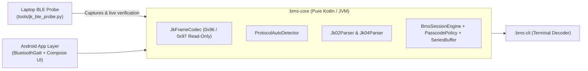

<div align="center">

# JK BMS Monitor (Read-Only)

**A lightweight, strictly read-only Bluetooth LE monitor for Jikong (JK) Battery Management Systems — built for safer everyday monitoring, clearer telemetry, and adaptive multi-window layouts.**


</div>

---

## Why This App Over the Official JK BMS Client

While the official JK BMS app packs full configuration and control menus into a dense interface, this project focuses purely on **safe, fast, distraction-free battery monitoring**:

- **Strict Read-Only Safety:** Protocol encoding (`JkFrameCodec`) restricts outbound traffic to read-only query frames (`0x97` Device Info and `0x96` Cell/Settings Info). It is impossible to accidentally toggle charge/discharge MOSFETs or alter protection thresholds while inspecting live metrics.
- **Cleaner Visual Hierarchy:** Replaces cluttered raw tables with an OLED-first dashboard featuring a circular SOC gauge, signed current/power arc, `0.001 V` cell delta readout, min/max cell highlights, and automatic `--` masking for disconnected temperature probes (`<= -100°C`).
- **Adaptive Multi-Window Layout:** Strictly OLED Dark (`#000000`) Compose UI that adapts dynamically across portrait, `50/50` split-screen (fitting SOC, Power, and Temps/MOS together on screen with all 24 cells scrollable below), `70/30` Rider HUD, landscape Navigation Rail, and tablet Bento layouts.
- **Battery-Conscious BLE Discovery:** Scans in short one-shot bursts rather than polling Bluetooth continuously in the background, paired with name/MAC search and QR lookup, while preserving active connections when switching tabs.
- **Automatic Protocol & Smart Passcode Flow:** Auto-detects `JK02_32S`, `JK02_24S`, and `JK04` frames (supporting both single- and dual-`0xFFE1` BLE modules), verifies the device passcode once per BMS MAC address, and unlocks automatically on subsequent connections.
- **Bilingual Support:** Instant switching between English and Vietnamese.

---

## Architecture

The protocol engine lives in a pure Kotlin/JVM module (`:bms-core`) with zero Android UI dependencies, allowing full verification against real BMS captures on a laptop before packaging into Android.



### Repository Structure

| Path | Purpose |
| :--- | :--- |
| [`app/`](app) | Android Jetpack Compose app (`minSdk 26`, `targetSdk 35`): `BluetoothGatt` read-only BLE client, `SharedPreferences` MAC passcode store, adaptive multi-window OLED Dark UI, Canvas gauges/charts, and offline 24S Demo mode. |
| [`bms-core/`](bms-core) | Pure Kotlin/JVM library: read-only frame codec, BLE chunk reassembly, CRC-8 check, `JK02_32S` / `JK02_24S` / `JK04` parsers, MAC passcode policy, and chart ring buffer. |
| [`bms-cli/`](bms-cli) | Command-line runner to decode and inspect captured hex frames through `:bms-core`. |
| [`tools/jk_ble_probe.py`](tools/jk_ble_probe.py) | Python `bleak` probe for Windows BLE testing, live telemetry readout, first-time passcode caching, and hex frame capture. |
| [`tools/app_preview.html`](tools/app_preview.html) | Interactive HTML overview of all app views and responsive window sizes. |
| [`tools/ui_designer.html`](tools/ui_designer.html) | Drag-and-drop layout studio used to customize and export `ui_layout.json`. |
| [`design-system/jk-bms-monitor/`](design-system/jk-bms-monitor) | Design tokens (`MASTER.md`, `tokens.json`, `ui_layout.json`). |

---

## JK BMS BLE Protocol Summary

Protocol decoding is based on community reverse-engineering documented in [`syssi/esphome-jk-bms`](https://github.com/syssi/esphome-jk-bms) and [`mazemingw/JKBMS-Android`](https://github.com/mazemingw/JKBMS-Android):

- **GATT Service / Characteristic:** `0xFFE0` / `0xFFE1` (filters characteristics by `WRITE` and `NOTIFY` properties to support newer modules that expose two `0xFFE1` characteristics).
- **Framing & Checksum:** `AA 55 90 EB` outbound 20-byte read requests; `55 AA EB 90` inbound 300-byte reassembled responses validated by 8-bit sum checksum at byte `299`.
- **Frame Types:** `0x01` Read-Only Settings, `0x02` Cell Voltages & Telemetry, `0x03` Device Info.
- **Verified Hardware:** Tested live against a 24S **JK-BD6A24S6PD** (`HW 20H`, `SW 20.25`, `JK02_32S` auto-detected).

---

## Local Verification (Laptop)

### Run Kotlin Backend Tests, Android Unit Tests & Build Debug APK

```powershell
# Run core tests and sample CLI
.\gradlew.bat :bms-core:test :bms-cli:run

# Run all tests and build Android debug APK (requires Android SDK in local.properties or ANDROID_HOME)
.\gradlew.bat :bms-core:test :app:testDebugUnitTest :app:assembleDebug
```

Output APK: `app\build\outputs\apk\debug\app-debug.apk`

### Live BLE Probe Against Hardware

Ensure Windows Bluetooth is enabled and close any phone app currently connected to the BMS (JK BMS hardware accepts one active BLE connection at a time):

```powershell
# Scan nearby BLE devices
tools\.venv\Scripts\python.exe tools\jk_ble_probe.py --scan-only

# Connect, verify passcode once, stream for 20s, and save raw 300-byte frames
tools\.venv\Scripts\python.exe tools\jk_ble_probe.py --duration 20 --save tools\my_24s.hex

# Decode the captured file using the Kotlin backend
.\gradlew.bat :bms-cli:run --args="C:\path\to\tools\my_24s.hex"
```

### Preview the UI Layout

```powershell
start tools\app_preview.html
```
